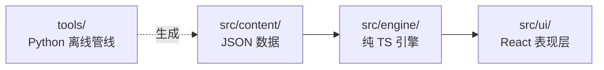

# 向火独行 · Alone Against the Flames

《克苏鲁的呼唤》第七版单人对战冒险的**网页版**。纯静态站点，无需后端，存档在浏览器本地。

> 原始文案与建卡规则由原书提供；本仓库是把它实现成可玩的电子游戏。版权说明见文末。

---

## 目录

- [快速开始](#快速开始)
- [技术栈](#技术栈)
- [三层架构](#三层架构)
- [引擎设计要点](#引擎设计要点)
- [内容管线](#内容管线)
- [测试与校验](#测试与校验)
- [内容缺口（诚实清单）](#内容缺口诚实清单)
- [已知限制与后续](#已知限制与后续)

---

## 快速开始

需要 **Node.js ≥ 20** 与 **Python ≥ 3.10**（Python 只用于离线内容工具，运行时不依赖它）。

```bash
npm install
npm run dev          # 开发服务器
npm run build        # 类型检查 + 生产构建到 dist/
npm run preview      # 预览构建产物
```

游戏本身不需要任何环境变量或后端服务，`dist/` 可以直接丢到任意静态托管上。

### 全部命令

| 命令 | 作用 |
| --- | --- |
| `npm run dev` | Vite 开发服务器 |
| `npm run build` | `tsc --noEmit && vite build`，类型不过就不出包 |
| `npm run preview` | 预览 `dist/` |
| `npm test` | Vitest 全量单测（166 个） |
| `npm run test:watch` | 单测 watch 模式 |
| `npm run script` | 由 `向火独行_ver15.txt` 重新生成 `src/content/scenes/script.json` |
| `npm run rules` | 由 xlsx 重新生成 `src/content/rules/*.json` |
| `npm run check` | 剧本校验器：结构 / 跳转 / 检定 / 效果 / 内容缺口 |

---

## 技术栈

- **构建**：Vite 6 + TypeScript 5.7（`strict`，`verbatimModuleSyntax`，`noUnusedLocals`）
- **UI**：React 19
- **测试**：Vitest 3
- **内容工具**：Python 3.13（仅离线，不进运行时）
- **运行时形态**：纯静态站点，`base: './'`，无后端、无账号、无云存档

---

## 三层架构



分层的硬规矩：**引擎层绝不 import React、绝不碰 DOM。**

这条规矩不是为了优雅，是为了让「能不能跑通整个剧本」变成一个可以用 Node 批量验证的问题——`playthrough.test.ts` 正是靠它才能让几百个随机角色在几毫秒内把剧本走一遍。

```
src/
  content/
    scenes/script.json        269 条正文 + 跳转 + 检定 + 效果
    rules/skills.json         91 项技能与基础值、别名、分组
    rules/occupations.json    115 个职业及其技能分配
    rules/specialties.json    50 项技能专攻（原表有 1 处重复「表演」，生成时去重）
    rules/rules.json          属性表、衍生属性、体格表、年龄调整
    rules/prebuilt.json       预建角色（夏洛特·范德米尔）
  engine/
    types.ts       全部类型的唯一定义处
    rng.ts         mulberry32 可播种随机数
    dice.ts        D100 检定、骰式解析、对抗检定
    character.ts   建卡、随机角色、成长
    names.ts       技能/属性名解析（含专攻、别名）
    conditions.ts  数据驱动的条件求值
    effects.ts     生命/理智/技能勾选
    state.ts       状态机：进入节点、结算检定、日志
    save.ts        localStorage 存档 + 版本迁移 + 导入导出
    gaps.ts        内容缺口登记表（读 tools/overrides.json）
  ui/
    App.tsx  SceneView.tsx  Actions.tsx  CharacterPanel.tsx
    LogPanel.tsx  CreateScreen.tsx  Menu.tsx  SaveMenu.tsx  useGame.ts
tools/
  txt_to_scenes.py     正文 → script.json（含异常报告）
  generate_rules.py    xlsx → rules/*.json
  validate_script.py   剧本校验器（npm run check）
  overrides.json       人工确认的修补规则 + 内容缺口登记表
```

---

## 引擎设计要点

### 1. 随机数必须可播种

`mulberry32`，状态就是一个 `number`，直接存进存档。否则读档后判定结果会变，玩家就会发现「存档重开能改命」——那游戏就没难度了。

### 2. 条件用数据描述，不用 `eval`

```ts
interface LinkCondition {
  attr: string
  op: ConditionOp
  value: number
}
```

好处不只是安全，而是**可静态校验**：校验器能在生成时检查每个 `attr` 是否真实存在，避免出现「点了没反应」或静默 0% 的死选项。

### 3. 效果的三个结算时机

原书大量把效果写在条件句里：「如果你失败了，失去 1D4 点理智值」。这类效果**不能在进入节点时结算**。

早期版本就是这么做的，于是结局 171 会同时扣掉成功分支的 1 点和失败分支的 1D4 点——玩家在故事结尾被多扣了 1~4 点理智，而且没有任何提示。

现在效果带一个前提字段，由引擎在**掷骰结果存在的地方**按结果挑着结算：

```ts
interface EffectBase { when?: 'success' | 'failure' }   // 缺省 = 进入节点即生效

selectEffects(effects, null)        // enter()        —— 只结算无前提的
selectEffects(effects, 'success')   // performCheck() —— 成功分支
selectEffects(effects, 'failure')   // performCheck() —— 失败分支
```

三个时机必须互不重叠。`effects.test.ts` 里有一组断言专门盯着这一点，包括一条「剧本里所有效果都能被某个时机认领」的穷举检查——漏掉任何一条都会被发现。

---

## 内容管线

```
向火独行_ver15.txt ──[txt_to_scenes.py]──> src/content/scenes/script.json
        │                                          │
        └──────────────────────────────────────────┴──> tools/_parse_report.txt
                                                          （解析异常 + 效果复核）
xlsx ──[generate_rules.py]──> src/content/rules/*.json
```

解析器的设计原则：**宁可吵，不可静。**

正文是 PDF 线性化的产物，双栏排版会带来各种错位。解析器遇到不确定的地方一律写进报告，绝不猜。需要人工判断的修补写进 `tools/overrides.json` 并附上理由，而不是让正则去揣摩作者意图。

`npm run script` 之后会生成 `tools/_parse_report.txt`，其中「效果复核」一节会列出**所有被丢弃的数字**及其原句——因为「不扣分」和「扣错分」都可能是 bug，必须看得见。

---

## 测试与校验

```bash
npm test        # 166 passed / 7 files
npm run check   # 0 个错误、0 个警告
```

### 单测分布

| 文件 | 数量 | 覆盖 |
| --- | --- | --- |
| `rng.test.ts` | 10 | 同种子可复现、分布合理 |
| `dice.test.ts` | 29 | 骰式解析、大成功/大失败边界、对抗检定 |
| `names.test.ts` | 33 | 属性/技能名解析、专攻、别名 |
| `character.test.ts` | 48 | 建卡、衍生属性、年龄调整、成长 |
| `content.test.ts` | 31 | 剧本结构、索引一致性、正文可用性 |
| `effects.test.ts` | 10 | 三个结算时机、内容侧硬约束 |
| `playthrough.test.ts` | 5 | 随机通关、穷举不变量 |

### 性价比最高的两个测试

**① 随机通关**（`playthrough.test.ts`）：200 个随机种子 × 随机角色在剧本里乱走，断言：不抛异常、不卡死（任何未结束状态都必须存在至少一个合法操作）、每一步都落在真实节点上、同种子结果完全一致。

**② 穷举不变量**：`for (node of SCRIPT.nodes) × 3 种角色`，断言每个非结局节点都有事可做（有跳转、有选择肢或有检定），且只有在节点含检定而无按钮时才强制要求成对分支。

这两个测试抓到过「单检定缺失败分支时无路可走」这类真 bug。它们不判断剧情对不对（那需要人来判断），只判断引擎的结构性不变量。

### 校验器自身也要验证

`validate_script.py` 第一次跑出 27 个错误，逐个核实后发现**约 25 个是校验器自己的错误假设**：

- 用 `range(1, max+1)` 算应有编号，没排除已登记的缺失编号 → 误报「缺少 [74]」
- 骰式正则只认 `NdM`，而引擎的 `parseDice` 接受**纯数字**和**多项相加** → 14 处合法的「失去 1 点」被判非法
- 用节点级 `any(outcome==='success')` 判断分支是否齐备 → 实测 45 条齐、2 条只有成功、2 条只有失败、10 条两边都没有（后果写在 `effects` 里），根本不是缺陷

教训：**检查器本身也是代码，必须先验证它**，否则会为了迁就一个错的正则去改正确的数据。

---

## 内容缺口（诚实清单）

以下是**源文本本身**的缺口，不是引擎 bug，也**没有被假装不存在**。全部登记在 `tools/overrides.json` 的 `knownGaps` 里，CLI 校验器与单测读同一份，两边不会各自漂移。

### 规模

| 项 | 数量 |
| --- | --- |
| 节点 | 269 |
| 跳转 | 407 |
| 检定点 | 59 |
| 效果 | 48（其中带成功/失败前提的 9 个） |
| kind 分布 | `text` 129 / `choice` 63 / `check` 54 / `ending` 15 / `combat` 5 / `dead_end` 3 |
| 静态可达 | 243 |
| **不可达** | **26** |

### 1. 原书的「相对跳转」机制未建模 —— 26 条不可达的根因

正文里有 5 处这样的段落：

> 如果你尝试这个仪式，**在你所在的条目号上加 40**，转到对应的条目。

目标是**运行时才确定的**（当前条目号 + N）。静态链接图里因此不存在固定入边，8 个条目零入边、26 个条目从起点走不到。

已核实的机制证据：条目 112 教了「隐藏阶梯」要求加 100，而 112 + 100 = 212 的正文正是「你迫不及待地想现在就尝试这道阶梯」——对得上。

后果：**18 个结局里有 7 个目前不可玩**，包括最好的那几个。

处理：暂时登记为已知缺口。正确做法是在引擎里把相对跳转建模成一等公民（`SceneLink.relativeTo`），而不是在解析器里猜目标。见[已知限制与后续](#已知限制与后续)。

零入边的 8 个条目：`50, 80, 90, 107, 171, 187, 200, 212`

### 2. 条目 74 整条丢失

条目 68 的失败分支写「转到 74」，但 74 的编号行与正文在源文本里**完全不存在**。

引擎遇到它的行为是**如实中断**（`interrupted`），界面提示「这一条在原书里没有出口（原始文本缺页）。这不是你的操作失误，可以读档换一条路」——不假造一条路，也不抛异常。

### 3. 正文在 PDF 分页处被截断

条目 `49`、`73` 停在一句话中间（页边界正好切过）；条目 `184` 则是原书本来就到此为止。三者都以 `interrupted` 收尾。

### 4. 条目 50 的正文位置错乱

PDF 双栏线性化导致条目 50 的正文段落被排到了「48」的标题块里。目前用 `overrides.json` 里一条 `moveParagraphs` 规则修补（附证据：条目 36 写「进行一次『攀爬』检定，如果你成功了，转到 48」，而这段被位移的正文正是攀爬成功→转到 61，语义吻合）。更好的做法是把它记成显式解析异常。

### 5. 重复正文

`[80, 90]`、`[136, 143]`、`[211, 216]` 三组条目的正文完全相同，疑似源文本重复。

### 6. 排查过程中被丢弃的数字

解析器的效果识别会**主动丢弃**说明句与怪物数据里的骰子，全部记录在 `tools/_parse_report.txt` 的「效果复核」一节。目前共 4 处：

| 条目 | 被丢弃 | 原因 |
| --- | --- | --- |
| 141 | `1`、`2` | 「你可以使用普通六面骰来投掷：1、2、3 表示失去 1 点理智值…」是**教学文字**，不是损失 |
| 173 | `2D6`、`1D8` | 「黑熊的爪击造成 2D6 点伤害」是**敌人的**伤害，不该扣玩家 |

条目 262 同理（「每次攻击成功会造成 1D3+1D4 点伤害」是工匠的拳伤），因此它没有 hp 效果。`effects.test.ts` 里有一条**反向护栏**断言它必须保持 `[]`，防止将来有人「顺手补上」。

---

## 已知限制与后续

按优先级：

1. **建模相对跳转** —— 让 8 个孤儿条目（含 3 个最佳结局）可玩，之后整张不可达名单可以删掉。
2. **UI 展示效果前提** —— `describeEffect` 已经会输出 `（成功）/（失败）` 前缀，界面还没用上。
3. **战斗系统** —— 当前 5 个 `combat` 节点用「检定 + 失败扣血」近似，真回合制战斗**排在最后**，理由见下。
4. **美术与音频** —— 立绘 / 背景 / BGM，授权信息待补。
5. **部署** —— `base: './'` 已配好，可直接上 Vercel 或 GitHub Pages。

### 为什么战斗最后做

整套 CoC 战斗规则（战斗轮、敏捷序、伤害加值、格斗/闪避对抗、重伤与昏迷）的系统复杂度已经**接近甚至超过**它那 5 个节点的内容量。先把叙事主干玩通，再决定这 5 个节点值不值得升级。否则很容易做出一个「引擎很完整、游戏没得玩」的东西。

---

## 版权与致谢

- 《向火独行》（*Alone Against the Flames*）原作与《克苏鲁的呼唤》第七版规则版权归 **Chaosium Inc.** 所有。
- 中文译文的译者与 `（译注…）` 内容归译者所有。
- 本仓库的**代码**（`src/engine/`、`src/ui/`、`tools/`）是原创实现。
- 仓库内包含的剧本正文、docx、xlsx 仅作**个人学习与开发**之用，**不再分发**。此仓库为 private，请勿转为公开。
- 界面回退链里保留了 `Microsoft YaHei` 这类系统字体。作为**回退**是安全的（不随包分发，不构成再分发）；但如果要把字体**内嵌**进 `dist/`（webfont），那才是需要确认授权的行为——
  那种情况请换用 OFL 字体，如思源黑体 / 思源宋体 / 霞鹜文楷。
